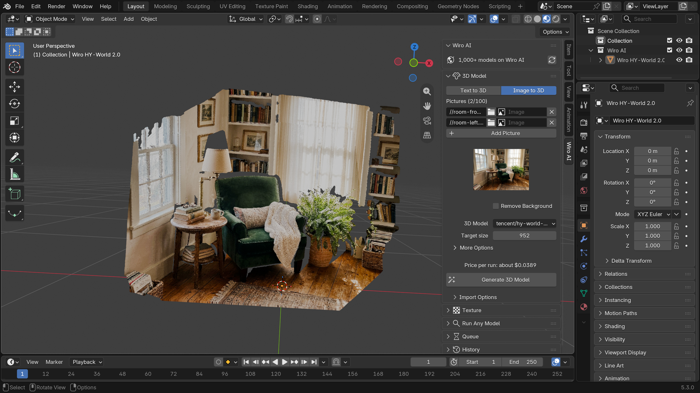
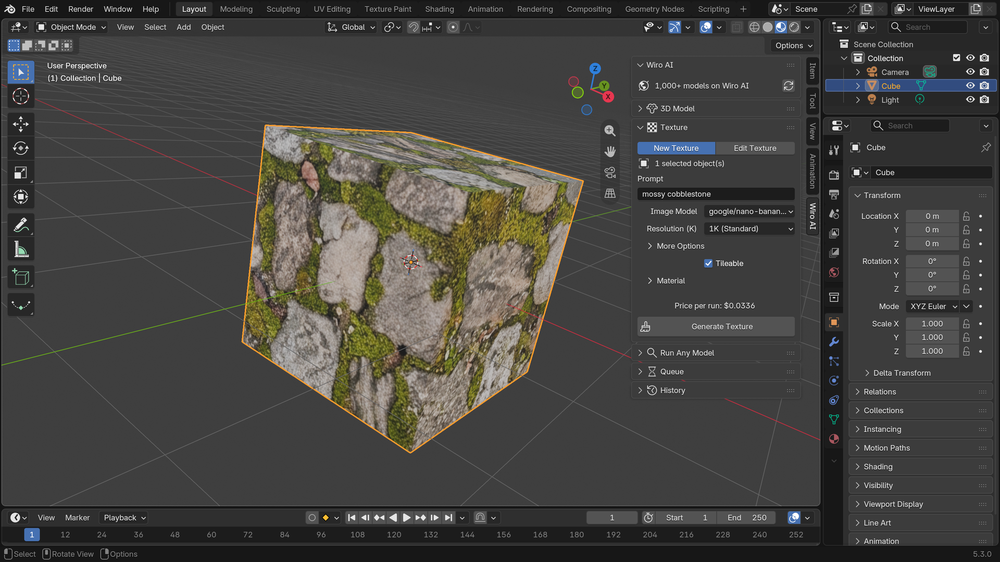
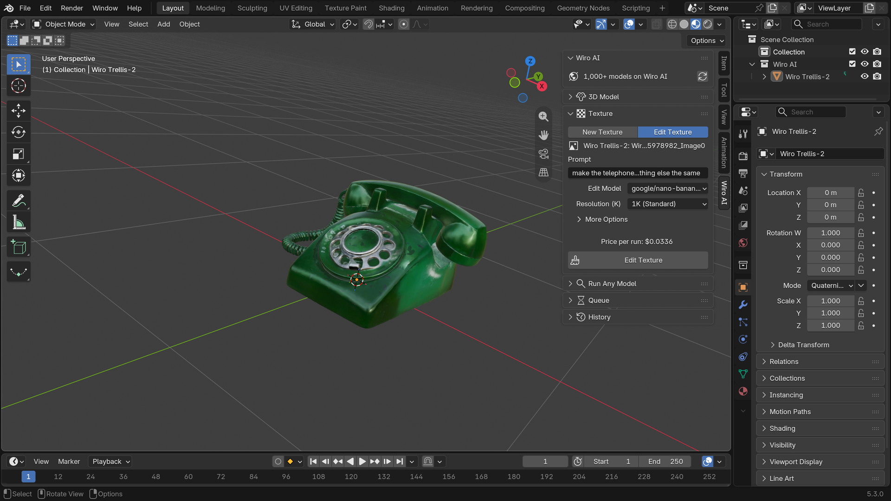
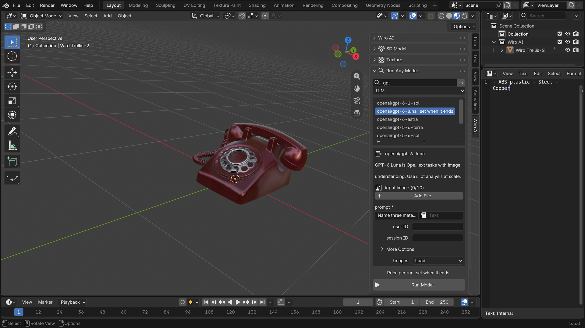
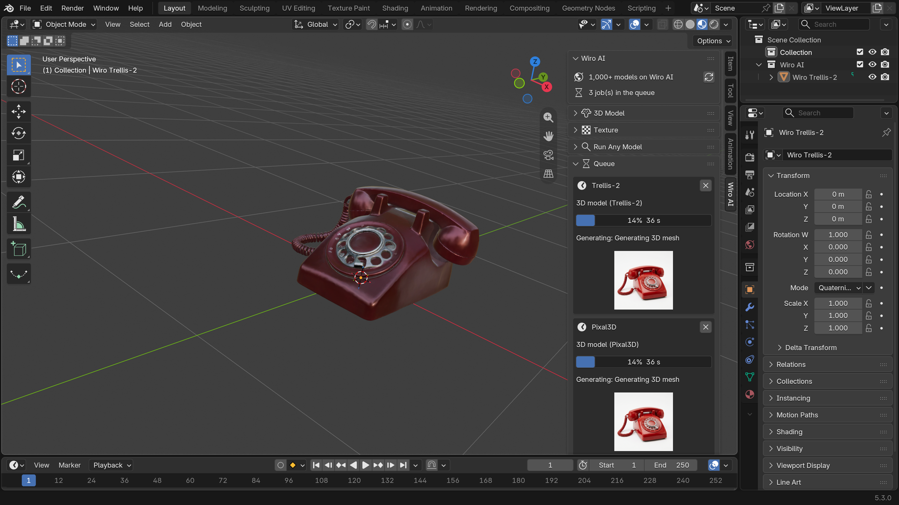

<div align="center">


# Wiro AI 3D Generator for Blender

Text to 3D, image to 3D, textures and any of the 1,000+ Wiro AI models in the 3D Viewport sidebar, with the results brought into your scene.

[](#install) [](https://github.com/wiroai/Wiro-Blender/actions/workflows/ci.yml) [](https://github.com/wiroai/Wiro-Blender/releases/latest) [](./LICENSE)

[Website](https://wiro.ai) · [Models](https://wiro.ai/models) · [Docs](https://wiro.ai/docs) · [Dashboard](https://wiro.ai/panel)

</div>

The add-on adds a **Wiro AI** tab to the sidebar of the 3D Viewport. Describe an object or pick pictures of it and get a textured 3D model at the 3D cursor. Put a texture on the selected objects from a prompt, or change the texture a model already has. Search the Wiro AI catalog and run any model with a form built from its settings. The models run on [Wiro AI](https://wiro.ai), so nothing runs on your GPU, and the add-on needs no extra Python packages.


## What it does

- **Text to 3D.** An image model draws a reference picture of your prompt, one whole object on a plain background. The background can be removed with a background removal model, then a 3D model builds the mesh from the picture.
- **Image to 3D.** Upload a PNG, JPEG or WebP picture of one object, or pick an image that is already in the .blend file. A model that takes several pictures gets several: HY-World 2.0 rebuilds a scene from a few photos and comes in as a colored point cloud.
- **Textures.** Make a tileable texture from a prompt and put it on the selected objects as a material: the image model makes the base color, and the material derives a bump and a roughness from it. UV mapping or box projection, with tiling, bump and roughness settings.
- **Edit Texture.** Change the base color texture of the active object with a prompt, for example to repaint a generated model. The texture keeps its UV layout.
- **Run Any Model.** Search the catalog, pick a model, and fill in a form built from its settings. Pictures come in as images or textured planes, 3D files as objects, audio as sounds, video as movie clips and LLM answers as text blocks.
- **Live model lists.** Each picker lists a Wiro AI category, so models that join the catalog show up without an add-on update. Each panel shows the price per run for the current settings before you press the button, and the header shows your wallet balance once it has been read.
- **Queue.** Start several jobs; two run at the same time by default and the rest wait. Each one has a progress bar, the step the model reports and a Cancel button that stops the task on Wiro AI.
- **Import options.** Place models at the 3D cursor or the world origin, put the origin at the bottom center or the bounds center, scale them or fit them to a size, collect them in a Wiro AI collection, and drop the empty parent a file brings.
- **History.** Every finished run is kept with its files, prompt and cost: import a model again, apply a texture again, reuse a prompt or send a reference picture to Image to 3D.
- **Scripting.** In background mode (`blender -b`), the operators wait for the models, print their progress and bring the results in.

## Install

**From the Wiro AI extension repository**, so Blender shows new versions as updates:

1. In Blender 4.2 or later, open **Edit > Preferences > Get Extensions**.
2. Open the **Repositories** menu at the top right, click **+** and choose **Add Remote Repository**. Enter this URL and click **Create**:

   ```
   https://wiroai.github.io/Wiro-Blender/index.json
   ```

3. Search for **Wiro AI** in **Get Extensions** and click **Install**. New versions appear under **Check for Updates** in the same menu.

**From a file:** download `wiro_ai-1.1.0.zip` from the [latest release](https://github.com/wiroai/Wiro-Blender/releases/latest) and drag it into Blender, or choose **Install from Disk** in the menu at the top right of **Get Extensions**.

The models run online, so **Allow Online Access** has to be on (**Edit > Preferences > System > Network**). The panel tells you when it is off.

## Set your API key

Create a project at [wiro.ai/panel/project/new](https://wiro.ai/panel/project/new) and copy its API key. Then open **Edit > Preferences > Add-ons > Wiro AI 3D Generator** and paste it into **API key**. If the project uses signature-based authentication, paste the API secret too. **Check API Key** asks Wiro AI whether the key works and reads your wallet balance, which is free.


The key stays in Blender's preferences, never in your .blend files, and it is only sent to `api.wiro.ai`. You can also set `WIRO_API_KEY` (and `WIRO_API_SECRET`) in the environment before you start Blender. The add-on uses them when the preferences are empty.

**Save files to** sets where generated files go. A path that starts with `//` is relative to the open .blend file. Left empty, files go to the add-on's own folder in your Blender user directory. **Jobs at Once** sets how many jobs run at the same time.

## The panels

Press **N** in the 3D Viewport to open the sidebar and click the **Wiro AI** tab.

### 3D Model

Choose **Text to 3D** or **Image to 3D**. For Text to 3D, write a prompt, for example *a red vintage rotary telephone*, and pick the image model. **Frame for 3D** (on by default) adds a short instruction that asks for one whole object, centered on a plain background, which is what image-to-3D models work best with. **Remove Background** adds a background removal step before the 3D model. Then pick the 3D model and press **Generate 3D Model**. Each model shows its own settings, with the ones that matter most in Blender up front and the rest under **More Options**.



### Texture

**New Texture** makes a texture from a prompt, for example *mossy cobblestone*, and puts it on every selected object. **Tileable** asks for a seamless texture. Under **Material** you set the mapping (Auto uses the UV map when there is one and box projection otherwise), the tiling, the bump strength and the base roughness, and whether the new material replaces the old ones.



**Edit Texture** sends the base color texture of the active object to an image editing model with your prompt and puts the result in its place. The material is copied first if other objects share it, and Undo brings the old texture back.



### Run Any Model

Type a few words, pick a category if you like and press the arrow. Pick a model from the list and its settings appear as a form; required settings have a star. Long prompts and JSON can come from a text block in the Text Editor. File settings take local files, https URLs or images from the .blend file.



### Queue and History

The Queue panel lists running and waiting jobs with their progress, the step the model reports and a preview of the latest picture, so you can, for example, send one picture to several 3D models and compare what comes back. The History panel keeps every finished run, newest first, with what it made, how long it took and what it cost.



## Models

The pickers list the Wiro AI catalog by category, so this table is the starting point rather than the full list.

| Panel | Category | Starts with | Also listed today |
| --- | --- | --- | --- |
| 3D Model | 3D generation | [Trellis-2](https://wiro.ai/models/microsoft/trellis-2) (Microsoft) | [Pixal3D](https://wiro.ai/models/tencentarc/pixal3d), [Hunyuan3D-2.1](https://wiro.ai/models/tencent/hunyuan3d-2-1), [HY-World 2.0](https://wiro.ai/models/tencent/hy-world-2-0-world-reconstruction) for several pictures |
| Reference picture, New Texture | Text to image | [Nano Banana 2.1](https://wiro.ai/models/google/nano-banana-2-1) (Google) | [GPT Image 2.6 Flare](https://wiro.ai/models/openai/gpt-image-2-6-flare) and more than 30 others |
| Edit Texture | Image editing | [Nano Banana 2.1](https://wiro.ai/models/google/nano-banana-2-1) (Google) | [GPT Image 2.6 Flare](https://wiro.ai/models/openai/gpt-image-2-6-flare) and more than 30 others |
| Remove Background | Background removal | [Remove Background](https://wiro.ai/models/wiro/remove-background) (Wiro) | [RMBG 2.0](https://wiro.ai/models/briaai/rmbg-2-0), [BiRefNet](https://wiro.ai/models/zhengpeng7/birefnet), [Ideogram Remove Background](https://wiro.ai/models/ideogram/remove-background) |
| Run Any Model | Every category | | 1,000+ models for images, video, audio, 3D and LLMs |

For the 3D models the panel starts with settings that suit Blender: a 200,000 face limit and 2048 pixel textures for Trellis-2 and Pixal3D, and a 200,000 face limit for Hunyuan3D-2.1. **Reset Settings** under **More Options** puts a model's settings back.

## Scripting

The panel settings live on the scene as `bpy.context.scene.wiro_ai`, so a script can set them and call the operators. Models are picked by their slug:

```python
import bpy

settings = bpy.context.scene.wiro_ai
settings.mode = "TEXT"  # or "IMAGE", with settings.images
settings.prompt = "a ceramic teapot with a blue floral pattern"
settings.reference_model = "google/nano-banana-2-1"
settings.mesh_model = "microsoft/trellis-2"
settings.use_cutout = True
bpy.ops.wiro_ai.generate()

settings.texture_prompt = "polished walnut wood"
bpy.ops.wiro_ai.generate_texture()  # on the selected objects
bpy.ops.wm.save_as_mainfile(filepath="teapot.blend")
```

In background mode each operator returns once its result is in the scene. `--online-mode` allows network access for that run:

```bash
WIRO_API_KEY=your-api-key blender --background --online-mode --python teapot.py
```

## How it works

- Each run is a `POST /v1/Run/{owner}/{model}` request with multipart form data ([Run a Model](https://wiro.ai/docs/run-a-model)). A step passes the URL of its result to the next one: the reference picture to the background removal model, the cutout to the 3D model.
- The add-on polls `Task/Detail` every 3 seconds until the task reaches `task_postprocess_end`, checks the exit code and downloads the outputs ([Tasks](https://wiro.ai/docs/tasks)). When a model returns a textured and an untextured GLB, the textured one is imported.
- Model lists come from `Tool/List` by category and model settings from `Tool/Detail`. Both are public, so the add-on reads them without your key and caches them; a copy ships with the add-on for the first start and for offline use. The price before a run follows the model's price list the way Wiro AI bills it.
- The network work runs on background threads. A timer on Blender's main thread redraws the panels and brings results into the scene, so the interface stays responsive.
- Runs start only when you press a run button. While Allow Online Access is off nothing is sent at all. Output files are downloaded without your key, and the history file never holds it.

The extension asks Blender for two permissions: **network**, to send prompts and files to Wiro AI and download the results, and **files**, to read input files and save the results.

```
wiro_ai/            the extension, packaged with "blender --command extension build"
  api.py            Wiro AI REST client, standard library only
  schema.py         a model's settings from Tool/Detail, and the Run fields
  pricing.py        the price of a run for given settings
  catalog.py        model lists by category, cached, with the shipped copy in data/
  pipeline.py       jobs: one or more model runs in a row, on a worker thread
  runtime.py        queue, timer, history and catalog refreshes on the main thread
  forms.py          settings forms built from schemas, and the model pickers
  importer.py       3D files, point clouds, pictures, sound, video and text
  materials.py      textures as materials, and texture edits
  operators.py      the operators behind the buttons
  ui.py             the sidebar panels
tests/              unit tests and the scripts that run inside Blender
scripts/            update_catalog.py refreshes the shipped catalog copy
```

## Development

Unit tests and lint run without Blender:

```bash
pip install ruff pytest
ruff check . && ruff format --check .
python -m pytest
```

Validate and build the package with Blender 4.2 or later:

```bash
blender --command extension validate wiro_ai
mkdir -p dist
blender --command extension build --source-dir wiro_ai --output-dir dist
```

The smoke test installs the package and runs every panel through its real operator against a fake Wiro AI API, without network access:

```bash
blender --command extension install-file -r user_default dist/wiro_ai-1.1.0.zip
blender --background --factory-startup --python-exit-code 1 --python tests/blender/smoke_test.py -- tests/fixtures/cube.glb
```

`tests/blender/live_test.py` makes real runs and is billed to the key's wallet, so it stays out of CI. CI runs lint and the unit tests on Python 3.11 and 3.13, and the manifest check, build and smoke test on Blender 4.2.23 and 5.3.0. `python scripts/update_catalog.py` refreshes `wiro_ai/data/catalog.json` from the public catalog.

Pushing a tag such as `v1.1.0` runs the Release workflow: it builds the package with Blender, attaches it to the GitHub release and publishes the extension repository (`index.json` and an `index.html` page) on GitHub Pages.

## Pricing

Each run is billed to the Wiro AI wallet of the API key's project at the model's price. Every panel shows the price for its current settings above its button, and the History panel shows what each finished run cost. Some examples:

| Model | Price per run |
| --- | --- |
| Trellis-2 | $0.25 at 512, $0.30 at 1024, $0.35 at 1536 |
| Pixal3D | $0.30 at 1024, $0.42 at 1536 |
| Hunyuan3D-2.1 | $0.90 with textures, $0.30 without |
| HY-World 2.0 | by run time, a few cents for a few pictures |
| Nano Banana 2.1 (reference picture, texture, texture edit) | $0.0336 at 1K |
| Remove Background | by run time, about a tenth of a cent |

A Text to 3D run costs the picture plus the 3D model, for example $0.3342 for Nano Banana 2.1, Remove Background and Trellis-2 at 1024. The model pages on wiro.ai list the current prices.

## More from Wiro AI

| Repository | What it is |
| --- | --- |
| [Wiro-MCP](https://github.com/wiroai/Wiro-MCP) | Official MCP server for Wiro AI, [`@wiro-ai/wiro-mcp` on npm](https://www.npmjs.com/package/@wiro-ai/wiro-mcp) |
| [Wiro-Plugin](https://github.com/wiroai/Wiro-Plugin) | Wiro AI plugin for Cursor, Claude Code, Gemini CLI, Devin, Antigravity and Kiro |
| [Wiro-Skills](https://github.com/wiroai/Wiro-Skills) | Agent skills for images, image edits, video, music, speech, transcripts, 3D and model search |
| [Wiro-LLM](https://github.com/wiroai/Wiro-LLM) | Vercel AI SDK provider for chat, images, speech, transcription and video, [`@wiro-ai/wiro-llm` on npm](https://www.npmjs.com/package/@wiro-ai/wiro-llm) |
| [Wiro-ComfyUI](https://github.com/wiroai/Wiro-ComfyUI) | Wiro AI nodes for ComfyUI |
| [Wiro-Dify-Plugin](https://github.com/wiroai/Wiro-Dify-Plugin) | Wiro AI model provider and media tools for Dify |
| [Wiro-Zed](https://github.com/wiroai/Wiro-Zed) | Wiro AI MCP server for the Zed editor |
| [Wiro-Raycast](https://github.com/wiroai/Wiro-Raycast) | Wiro AI extension for Raycast |
| [Wiro-Action](https://github.com/wiroai/Wiro-Action) | GitHub Action for Wiro AI |
| [Wiro-Hermes](https://github.com/wiroai/Wiro-Hermes) | Wiro AI plugins for Hermes Agent: image, video, audio and 3D tools, plus the LLM gateway as a model provider |
| [Wiro-Next-Starter](https://github.com/wiroai/Wiro-Next-Starter) | Next.js starter for Wiro AI |
| [Wiro-WordPress](https://github.com/wiroai/Wiro-WordPress) | Wiro AI plugin for WordPress: featured images, image edits, alt text, narration and SEO suggestions |
| [Wiro-Obsidian](https://github.com/wiroai/Wiro-Obsidian) | Wiro AI plugin for Obsidian: images, video, speech, music, transcription and text tools |
| [Wiro-Figma](https://github.com/wiroai/Wiro-Figma) | Wiro AI plugin for Figma: images, vectors, image edits and text |
| [n8n-nodes-wiro](https://github.com/wiroai/n8n-nodes-wiro) | One Wiro AI node for n8n with a searchable model picker, [`@wiro-ai/n8n-nodes-wiro` on npm](https://www.npmjs.com/package/@wiro-ai/n8n-nodes-wiro) |
| [Wiro-Chromium-Extension](https://github.com/wiroai/Wiro-Chromium-Extension) | Wiro AI extension for Chrome, Edge, Opera, Whale and Brave |
| [Wiro-Firefox-Extension](https://github.com/wiroai/Wiro-Firefox-Extension) | Wiro AI add-on for Firefox |
| [Wiro-Safari-Extension](https://github.com/wiroai/Wiro-Safari-Extension) | Wiro AI extension for Safari on the Mac |
| [Swift-QuickStart](https://github.com/wiroai/Swift-QuickStart) | WiroKit, the Wiro AI SDK for iOS |
| [Kotlin-QuickStart](https://github.com/wiroai/Kotlin-QuickStart) | WiroKit, the Wiro AI SDK for Android |
| [Dart-QuickStart](https://github.com/wiroai/Dart-QuickStart) | Wiro AI SDK for Dart and Flutter, [`wiro` on pub.dev](https://pub.dev/packages/wiro) |
| [ReactNative-QuickStart](https://github.com/wiroai/ReactNative-QuickStart) | Wiro AI SDK for React Native and Expo, [`@wiro-ai/wiro-react-native` on npm](https://www.npmjs.com/package/@wiro-ai/wiro-react-native) |
| [Swift-Realtime](https://github.com/wiroai/Swift-Realtime) | Realtime voice AI example for iOS |
| [Kotlin-Realtime](https://github.com/wiroai/Kotlin-Realtime) | Realtime voice AI example for Android |
| [Dart-Realtime](https://github.com/wiroai/Dart-Realtime) | Realtime voice AI example for Flutter |
| [ReactNative-Realtime](https://github.com/wiroai/ReactNative-Realtime) | Realtime voice AI example for React Native |
| [Wiro-Docs](https://github.com/wiroai/Wiro-Docs) | Source of the Wiro AI API docs |

[Website](https://wiro.ai) · [Models](https://wiro.ai/models) · [Docs](https://wiro.ai/docs) · [X](https://x.com/wiroai)

## License

GPL-3.0-or-later, see [LICENSE](./LICENSE). Blender is a trademark of the Blender Foundation; this add-on is made by Wiro AI and is not affiliated with or endorsed by the Blender Foundation.
