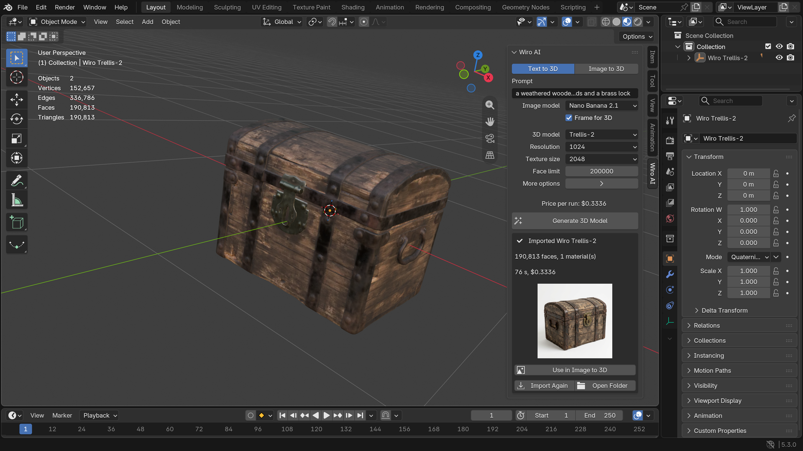
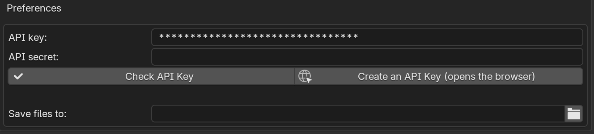
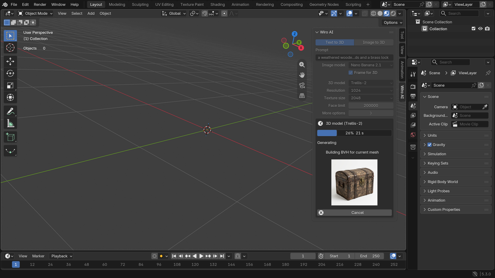
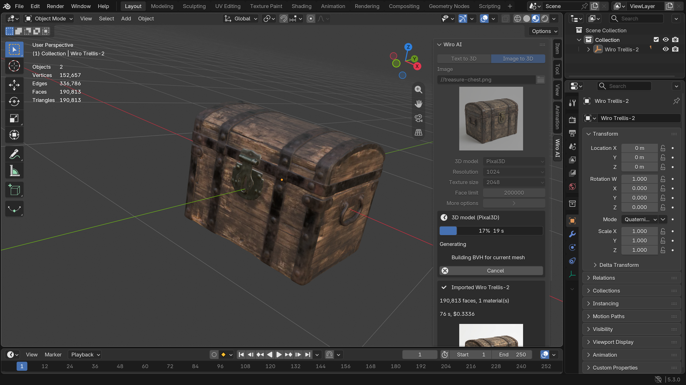

<div align="center">


# Wiro AI 3D Generator for Blender

Text to 3D and image to 3D in the 3D Viewport sidebar: Trellis-2, Pixal3D and Hunyuan3D-2.1 build a textured mesh on Wiro AI, and the add-on imports it into your scene as GLB.

[](#install) [](https://github.com/wiroai/Wiro-Blender/actions/workflows/ci.yml) [](./LICENSE)

[Website](https://wiro.ai) · [Models](https://wiro.ai/models) · [Docs](https://wiro.ai/docs) · [Dashboard](https://wiro.ai/panel)

</div>

The add-on adds a **Wiro AI** tab to the sidebar of the 3D Viewport. Describe an object or pick a picture of one, choose a 3D model and press **Generate 3D Model**. The model runs on [Wiro AI](https://wiro.ai), the panel follows the task with a progress bar, and the GLB lands at the 3D cursor with its PBR materials. Nothing runs on your GPU, and the add-on needs no extra Python packages.



## What it does

- **Text to 3D.** An image model draws a reference picture of your prompt, one whole object on a plain background, then a 3D model builds the mesh from it. The picture appears in the panel while the mesh is being built.
- **Image to 3D.** Upload a PNG, JPEG or WebP picture of one object.
- **Three 3D models:** Microsoft Trellis-2, Tencent ARC Pixal3D and Tencent Hunyuan3D-2.1, with their resolution, texture size and face limit settings.
- **Progress in the panel.** A progress bar, the task status and the step the model reports, such as "Generating 3D mesh" or "Exporting GLB". **Cancel** stops the task on Wiro AI.
- **Imported with Blender's own glTF importer.** The model is placed at the 3D cursor, named after the 3D model and selected, and the import can be undone. Each object keeps the model, the task ID and the prompt as custom properties.
- **Another model, same picture.** **Use in Image to 3D** sends the last reference picture to Image to 3D, so you can compare 3D models without drawing a new picture.
- **Scripting.** In background mode (`blender -b`), `bpy.ops.wiro_ai.generate()` waits for the model, prints its progress and imports the result.

## Install

1. Download `wiro_ai-1.0.0.zip` from the [latest release](https://github.com/wiroai/Wiro-Blender/releases/latest).
2. Drag the zip into Blender 4.2 or later. You can also open **Edit > Preferences > Get Extensions**, click the menu at the top right and choose **Install from Disk**.
3. The models run online, so **Allow Online Access** has to be on (**Edit > Preferences > System > Network**). The panel tells you when it is off.

## Set your API key

Create a project at [wiro.ai/panel/project/new](https://wiro.ai/panel/project/new) and copy its API key. Then open **Edit > Preferences > Add-ons > Wiro AI 3D Generator** and paste it into **API key**. If the project uses signature-based authentication, paste the API secret too. **Check API Key** asks Wiro AI whether the key works, which is free.



The key stays in Blender's preferences, never in your .blend files, and it is only sent to `api.wiro.ai`. You can also set `WIRO_API_KEY` (and `WIRO_API_SECRET`) in the environment before you start Blender. The add-on uses them when the preferences are empty.

**Save files to** sets where GLB files and reference pictures go. A path that starts with `//` is relative to the open .blend file. Left empty, files go to the add-on's own folder in your Blender user directory.

## Use it

Press **N** in the 3D Viewport to open the sidebar and click the **Wiro AI** tab.

**Text to 3D:** write a prompt, for example *a weathered wooden treasure chest with iron bands and a brass lock*, pick the image model and the 3D model, and press **Generate 3D Model**. **Frame for 3D** (on by default) adds a short instruction to the prompt that asks for one whole object, centered on a plain background, which is what image-to-3D models work best with.



**Image to 3D:** pick a picture of one object. A plain background works best, and the 3D models cut the object out themselves.



You can keep working in Blender while a model runs. When it finishes, the panel shows the face count, how long the run took and what it cost.

## Models

| 3D model | Made by | Settings in the panel | Model page |
| --- | --- | --- | --- |
| **Trellis-2** | Microsoft | resolution 512, 1024 or 1536, texture size 1024 to 8192, face limit | [microsoft/trellis-2](https://wiro.ai/models/microsoft/trellis-2) |
| **Pixal3D** | Tencent ARC | resolution 1024 or 1536, texture size 1024 to 8192, face limit | [tencentarc/pixal3d](https://wiro.ai/models/tencentarc/pixal3d) |
| **Hunyuan3D-2.1** | Tencent | textures on or off, face limit up to 200,000, octree resolution, background removal | [tencent/hunyuan3d-2-1](https://wiro.ai/models/tencent/hunyuan3d-2-1) |

| Image model (Text to 3D) | Made by | Output | Model page |
| --- | --- | --- | --- |
| **Nano Banana 2.1** | Google | 1024 x 1024 PNG | [google/nano-banana-2-1](https://wiro.ai/models/google/nano-banana-2-1) |
| **GPT Image 2.6 Flare** | OpenAI | 1024 x 1024 PNG with a transparent background | [openai/gpt-image-2-6-flare](https://wiro.ai/models/openai/gpt-image-2-6-flare) |

The 3D models return a GLB with PBR materials; Hunyuan3D-2.1 with textures off returns a plain white mesh. **Seed**, under **More options**, repeats a result for the same inputs, and 0 picks a random seed.

These five come from the Wiro AI catalog of 1,000+ models for images, video, audio, 3D and LLMs at [wiro.ai/models](https://wiro.ai/models).

## Scripting

The panel settings live on the scene as `bpy.context.scene.wiro_ai`, so a script can set them and call the operator:

```python
import bpy

settings = bpy.context.scene.wiro_ai
settings.mode = "TEXT"  # or "IMAGE", with settings.image_path
settings.prompt = "a ceramic teapot with a blue floral pattern"
settings.image_model = "NANO_BANANA_2_1"  # or "GPT_IMAGE_2_6_FLARE"
settings.mesh_model = "TRELLIS_2"  # or "PIXAL3D", "HUNYUAN3D_2_1"
settings.trellis_resolution = "1024_cascade"
bpy.ops.wiro_ai.generate()
bpy.ops.wm.save_as_mainfile(filepath="teapot.blend")
```

In background mode the operator returns once the model is imported. `--online-mode` allows network access for that run:

```bash
WIRO_API_KEY=your-api-key blender --background --online-mode --python teapot.py
```

## How it works

- Each run is a `POST /v1/Run/{owner}/{model}` request with multipart form data ([Run a Model](https://wiro.ai/docs/run-a-model)). In Text to 3D the 3D model receives the URL of the reference picture; in Image to 3D it receives your file.
- The add-on polls `Task/Detail` every 3 seconds until the task reaches `task_postprocess_end`, checks the exit code and downloads the GLB ([Tasks](https://wiro.ai/docs/tasks)). When a model returns a textured and an untextured GLB, the textured one is imported.
- The network work runs on a background thread. A timer on Blender's main thread redraws the panel and runs the import, so the interface stays responsive.
- Nothing is sent until you press **Generate 3D Model** or **Check API Key**, and nothing is sent while Allow Online Access is off. Output files are downloaded without your key.

The extension asks Blender for two permissions: **network**, to send prompts and images to Wiro AI and download the models, and **files**, to read input images and save the generated GLB files.

```
wiro_ai/            the extension, packaged with "blender --command extension build"
  api.py            Wiro AI REST client, standard library only
  catalog.py        models, settings and prices
  pipeline.py       one generation job on a worker thread
  runtime.py        timer, import and previews on the main thread
  ui.py             sidebar panel and operators
  preferences.py    API key and output folder
  properties.py     panel settings, stored per scene
  importer.py       GLB import with Blender's glTF importer
tests/              unit tests and the scripts that run inside Blender
```

## Development

Unit tests and lint run without Blender:

```bash
pip install ruff pytest
ruff check . && ruff format --check .
python -m pytest
```

Validate and build the package with Blender 4.2 or later:

```bash
blender --command extension validate wiro_ai
blender --command extension build --source-dir wiro_ai --output-dir dist
```

The smoke test installs the package and runs both modes through the real operator against a fake Wiro AI API, without network access:

```bash
blender --command extension install-file -r user_default dist/wiro_ai-1.0.0.zip
blender --background --factory-startup --python-exit-code 1 --python tests/blender/smoke_test.py -- tests/fixtures/cube.glb
```

`tests/blender/live_test.py` makes one real generation and is billed to the key's wallet, so it stays out of CI. CI runs lint and the unit tests on Python 3.11 and 3.13, and the manifest check, build and smoke test on Blender 4.2.23 and 5.3.0.

## Pricing

Each run is billed to the Wiro AI wallet of the API key's project at the model's price. The panel shows the price of the current settings above the Generate button, and the cost of each finished run.

| Model | Price per run |
| --- | --- |
| Trellis-2 | $0.25 at 512, $0.30 at 1024, $0.35 at 1536 |
| Pixal3D | $0.30 at 1024, $0.42 at 1536 |
| Hunyuan3D-2.1 | $0.90 with textures, $0.30 without |
| Nano Banana 2.1 (Text to 3D) | $0.0336 per picture |
| GPT Image 2.6 Flare (Text to 3D) | $0.043 per picture |

A Text to 3D run costs the picture plus the 3D model, for example $0.3336 for Nano Banana 2.1 with Trellis-2 at 1024. The model pages on wiro.ai list the current prices.

## More from Wiro AI

| Repository | What it is |
| --- | --- |
| [Wiro-Blender](https://github.com/wiroai/Wiro-Blender) | Wiro AI 3D Generator for Blender (this repository) |
| [Wiro-MCP](https://github.com/wiroai/Wiro-MCP) | Official MCP server for Wiro AI, [`@wiro-ai/wiro-mcp` on npm](https://www.npmjs.com/package/@wiro-ai/wiro-mcp) |
| [Wiro-Plugin](https://github.com/wiroai/Wiro-Plugin) | Wiro AI plugin for Cursor, Claude Code, Gemini CLI and Devin |
| [Wiro-LLM](https://github.com/wiroai/Wiro-LLM) | Wiro AI provider for the Vercel AI SDK and LLM gateway examples, [`@wiro-ai/wiro-llm` on npm](https://www.npmjs.com/package/@wiro-ai/wiro-llm) |
| [Wiro-ComfyUI](https://github.com/wiroai/Wiro-ComfyUI) | Wiro AI nodes for ComfyUI |
| [Wiro-Dify-Plugin](https://github.com/wiroai/Wiro-Dify-Plugin) | Wiro AI model provider and media tools for Dify |
| [Wiro-Zed](https://github.com/wiroai/Wiro-Zed) | Wiro AI MCP server for the Zed editor |
| [Wiro-Raycast](https://github.com/wiroai/Wiro-Raycast) | Wiro AI extension for Raycast |
| [Wiro-Action](https://github.com/wiroai/Wiro-Action) | GitHub Action for Wiro AI |
| [Wiro-Hermes](https://github.com/wiroai/Wiro-Hermes) | Wiro AI as a model provider for Hermes Agent |
| [Wiro-Next-Starter](https://github.com/wiroai/Wiro-Next-Starter) | Next.js starter for Wiro AI |
| [n8n-nodes-wiroai](https://github.com/wiroai/n8n-nodes-wiroai) | Wiro AI nodes for n8n, [`@wiro-ai/n8n-nodes-wiroai` on npm](https://www.npmjs.com/package/@wiro-ai/n8n-nodes-wiroai) |
| [Wiro-Chromium-Extension](https://github.com/wiroai/Wiro-Chromium-Extension) | Wiro AI extension for Chrome, Edge, Opera, Whale and Brave |
| [Wiro-Firefox-Extension](https://github.com/wiroai/Wiro-Firefox-Extension) | Wiro AI add-on for Firefox |
| [Wiro-Safari-Extension](https://github.com/wiroai/Wiro-Safari-Extension) | Wiro AI extension for Safari on the Mac |
| [Swift-QuickStart](https://github.com/wiroai/Swift-QuickStart) | WiroKit, the Wiro AI SDK for iOS |
| [Kotlin-QuickStart](https://github.com/wiroai/Kotlin-QuickStart) | WiroKit, the Wiro AI SDK for Android |
| [Dart-QuickStart](https://github.com/wiroai/Dart-QuickStart) | Wiro AI SDK for Dart and Flutter, [`wiro` on pub.dev](https://pub.dev/packages/wiro) |
| [ReactNative-QuickStart](https://github.com/wiroai/ReactNative-QuickStart) | Wiro AI SDK for React Native and Expo, [`@wiro-ai/wiro-react-native` on npm](https://www.npmjs.com/package/@wiro-ai/wiro-react-native) |
| [Swift-Realtime](https://github.com/wiroai/Swift-Realtime) | Realtime voice AI example for iOS |
| [Kotlin-Realtime](https://github.com/wiroai/Kotlin-Realtime) | Realtime voice AI example for Android |
| [Dart-Realtime](https://github.com/wiroai/Dart-Realtime) | Realtime voice AI example for Flutter |
| [ReactNative-Realtime](https://github.com/wiroai/ReactNative-Realtime) | Realtime voice AI example for React Native |
| [Wiro-Docs](https://github.com/wiroai/Wiro-Docs) | Source of the Wiro AI API docs |

[Website](https://wiro.ai) · [Models](https://wiro.ai/models) · [Docs](https://wiro.ai/docs) · [X](https://x.com/wiroai)

## License

GPL-3.0-or-later, see [LICENSE](./LICENSE). Blender is a trademark of the Blender Foundation; this add-on is made by Wiro AI and is not affiliated with or endorsed by the Blender Foundation.
